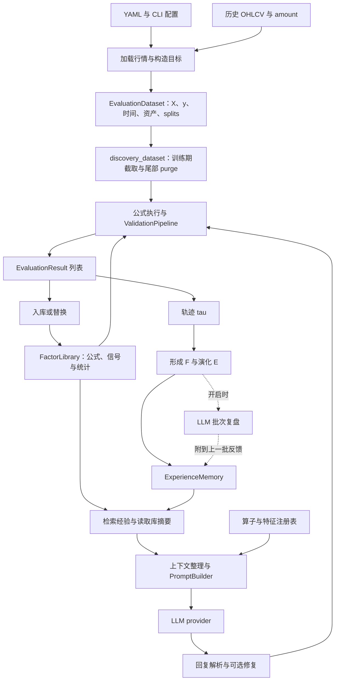
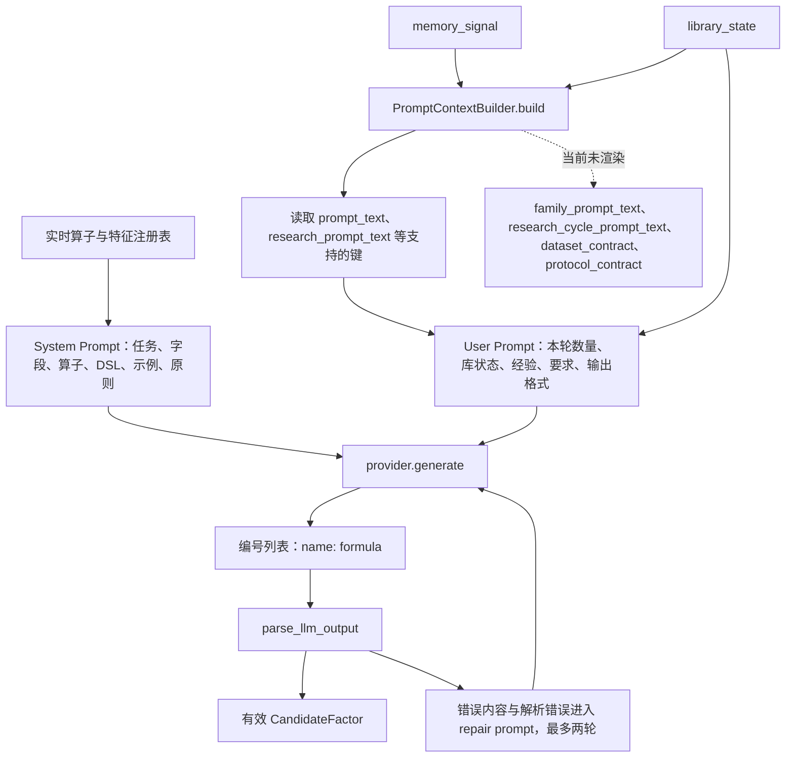
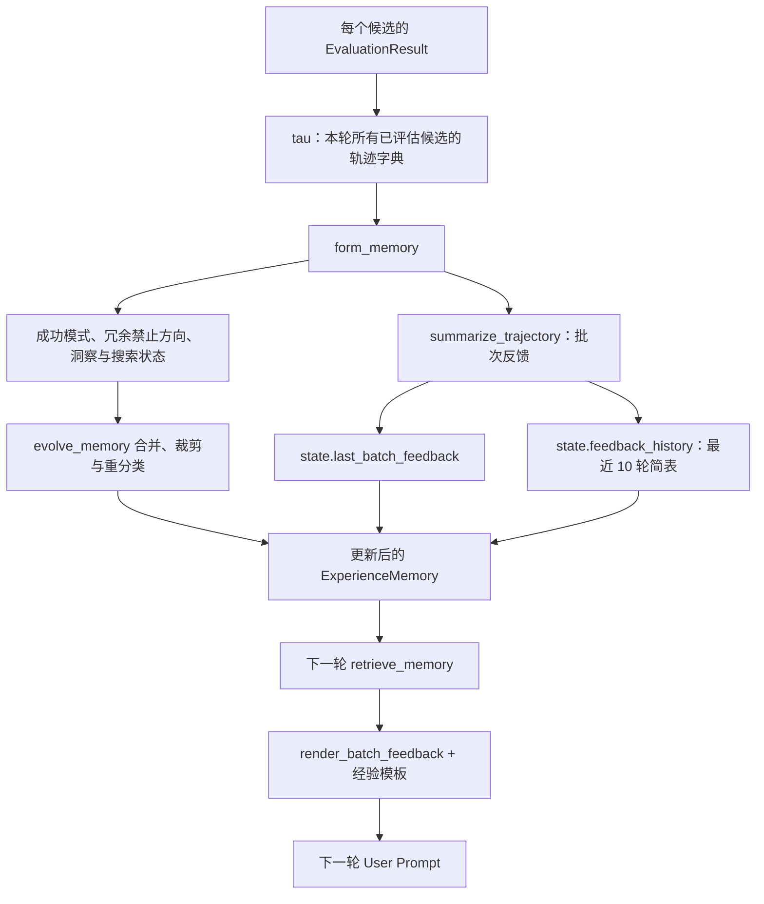

# 当前 FactorMiner 构造与信息流

核查日期：2026-10-23。对象：本地当前工作树，包括尚未提交的修改。本文基于代码静态追踪，不表示已启动真实行情挖掘或验证云端追踪连接。

主线：CLI `mine` → RalphLoop。Helix、研究动作、导入研究知识与分析命令作为分支说明；`memory-hypothesis-implementation-spec.md` 中尚未实现的分层账本不计入当前能力。

## 1. 总体输入输出

| 输入 | 去向 | 说明 |
| --- | --- | --- |
| 行情 CSV/Parquet/HDF5 | 数据加载、预处理、目标构造 | 标准列 datetime/asset_id/open/high/low/close/volume/amount；可派生 vwap/returns |
| 默认 YAML + 用户 YAML + CLI 参数 | 配置与 MiningSettings | 决定时间窗、目标、LLM、阈值、记忆策略、输出路径 |
| LLM 凭据与模型配置 | provider | 不属于行情特征或挖掘证据 |
| 已保存库或 checkpoint | 因子库、记忆、循环状态 | 默认同一输出目录可恢复 checkpoint；新实验使用新目录 |
| 已导入研究记录 | ResearchKnowledgeStore | 只有存在记录时，才可能补充 research_prompt_text |

| 输出 | 内容 |
| --- | --- |
| 因子库 | 接受的公式、统计、分类、来源与可恢复信号 |
| 经验记忆 | S、P_succ、P_fail、I，以及上一批反馈、短历史 |
| 候选结局与轨迹 | 每个进入评估的候选的质量、冗余、阶段和替换信息 |
| 运行记录 | 配置、数据标识、模型描述、成本与耗时、checkpoint |
| 调用追踪 | 每阶段输入输出、LLM prompt、原始回复、token、可用时的 thinking |
| 独立分析 | evaluate/combine/visualize/report 等命令生成，不等于 mine 默认每轮反馈 |

默认配置当前为：40 个候选/批、目标 110、IC 0.04、相关阈值 0.5、ICIR 门槛 0、训练期隔离开启、原始字段 z-score/winsorize 关闭、初始记忆 empty、paper memory policy、LLM reflection 关闭。用户配置可覆盖；这不是对某个已经运行的 campaign 的断言。

## 2. 行情与生成信息两条路径

X 为 `(M,T,F)`，y 为 `(M,T)`；公式输出 signal 为 `(M,T)`。M 为资产数、T 为 bar 数、F 为特征数。默认目标 `y[m,t] = close[m,t+1]/open[m,t+1]-1`，由原始行情计算；它与输入字段 `$returns`（历史 close-to-close 收益）不同。

默认数据处理仍执行派生字段、停牌掩码与缺失填充。当前 discovery_dataset 在已经建立的训练 split 上切片，并保守删除尾部 `max(entry_delay + holding)` 个 bar；它没有另外向训练起点之前扩展公式 warm-up。滚动公式开头仍可能产生 NaN。

原始行情面板和逐 bar 未来收益不会在普通主线自动序列化进生成 prompt。LLM 接收字段/算子说明、库摘要和筛选后的经验文本；数值评分由 Python 执行。

## 3. 一轮如何传递状态

`IterationPayload` 是同一轮的共享载体，不是独立持久化数据库。

| 阶段 | 主要输入 | 写回 payload/持久状态 |
| --- | --- | --- |
| retrieve | memory、library.get_state_summary() | library_state、memory_signal |
| 研究知识补充 | 已导入的研究假设与库摘要 | 给 memory_signal 增加 research_archetypes、来源与假设 ID |
| generate | memory_signal、library_state、dataset_contract | prompt_context、candidates |
| evaluate | candidates、训练 X/y、库信号 | results；同时写生命周期与 trial ledger |
| library_update | results | admitted_results；修改 FactorLibrary |
| distill | 本轮全部评估 results 形成的 tau | form/evolve 更新 memory；可选复盘附到 feedback |
| 收尾 | payload 与累计状态 | 统计、来源、研究结果记录、追踪、session/checkpoint |

`candidates` 是 `(name, formula)` 列表，`results` 是 `EvaluationResult` 列表。持久库和记忆由 loop 持有，不是每轮重新开始。

生成器会先丢弃修复后仍不能解析的回复。因此，普通 mine 的评估结果数量、feedback.total 不一定等于请求数或原始回复行数。生成修复轨迹需要在调用追踪里看。

## 4. Prompt 的实际构造

System Prompt 在 PromptBuilder 初始化时构造，包含任务描述、特征名称与说明、算子分类/参数/范围、嵌套调用语法、表达式示例和生成原则。普通 Ralph 构造时使用 `PromptBuilder()`，默认任务措辞为股票选因子；数据配置中的市场/频率/目标并未通过 dataset_contract 自动变成完整任务说明。

User Prompt 按当前代码顺序拼接：

1. Generate exactly N novel, diverse alpha factor candidates。
2. CURRENT LIBRARY STATUS：规模/目标、IC/相关门槛、分类、最近最多 40 条库公式及 Paper IC。
3. EXPERIENCE MEMORY：优先插入 memory_signal.prompt_text；只有为空时才逐项格式化结构化列表，避免重复渲染。
4. RESEARCH CONTEXT：有 research_prompt_text 时插入。
5. 有提供时插入 complementary_patterns、conflict_warnings、operator_cooccurrence、semantic_gaps。
6. ORTHOGONALITY：要求与库成员低相关、避免只换窗口。
7. OUTPUT FORMAT：编号、因子名、公式；不要解释文字。

PaperMemoryPolicy 当前检索上限为 8 条成功模式、10 条禁止方向、10 条洞察，并附上批反馈。结构化上下文字典不等于最终请求文本；family/research-cycle 字段已计算但普通 PromptBuilder 不读取。外部研究上下文则有明确 research_prompt_text 渲染路径。

普通调用使用 system/user 两段语义输入；provider 按厂商要求转换。例如当前 Google 实现把两段拼接成一个文本请求。生成时默认 temperature 0.8、max_tokens 4096；真实配置可覆盖。

修复 prompt 是独立调用，带坏公式与可获得的解析错误，使用同一算子说明；它不重新携带完整普通 user prompt。修复最多两轮、初始最多取 15 个失败项，结束后只保留能解析的公式。请求 N 不保证最终得到 N。

## 5. 评估与反馈

当前真实执行顺序是：完整信号计算 → 小资产子集 IC 快筛 → 全资产统计/质量门槛 → 库间相关性/替换 → 批内去重 → 库更新时应用准入。不要把论文流程图里的 Stage 4 当成当前代码另一次独立延后计算。

默认 IC 为逐 bar 横截面 Spearman；准入质量为 `abs(mean(IC_t))`。库间 spearman 为 `abs(mean_t(rho_t))`。可选 ICIR gate 当前默认 0；批内去重使用 ic_paper_mean。

| EvaluationResult 字段 | 用途 |
| --- | --- |
| factor_name、formula、parse_ok | 识别与执行有效性 |
| ic_mean、ic_paper_mean、ic_abs_mean | 方向、论文质量口径、幅度诊断 |
| icir、ic_paper_icir、ic_win_rate | 稳定性与正 IC 频率 |
| signals、target_stats | 完整信号与目标统计 |
| max_correlation、correlated_with、conflict_count | 冗余与冲突库因子 |
| admitted、replaced、outcome | 结构化决定 |
| rejection_reason、replacement_note、duplicate_of | 拒绝、替换与批内竞争解释 |
| parent_formula 等 | 公式派生来源 |
| research_score、score_vector 等 | 启用研究评分时的额外诊断 |

反馈经过三种表示：

批次反馈字段：iteration、total、counts、yield_rate、admitted、near_misses、weak、implementation_errors、crowded_factors、diagnosis。列表有数量上限，公式与错误文本可能被截短；不包含全部信号数组或全部历史。

结局包括 admitted/replaced、redundant/batch_duplicate、low_ic/low_icir、parse_error/compute_error/invalid_signal，以及研究模式的 research_rejected。

diagnosis 是程序规则生成的建议，比如错误过多则修语法、冗余集中则换方向、连续三轮零入库则转向。数值由评估器提供，但建议措辞是启发式，不是对失败因果的实验证明。

开启 memory.llm_reflection 后，再由 LLM 阅读批次反馈与最近最多 30 条库公式，输出 observations/hypotheses/avoid。它附在 feedback.reflection 中，并在下一轮渲染；不直接改变数值、入库或经验计数。该开关默认关闭。

## 6. 当前记忆与日志不是一回事

ExperienceMemory 当前字段为 state、success_patterns、forbidden_directions、insights、version。state 中有库规模、近期接受/拒绝、饱和状态、准入历史、last_batch_feedback 与 feedback_history。

成功模式与禁止方向仍由规则/关键词形成，演化仍有按名称/词重叠合并或重分类的实现。多层骨架、独立 CandidateLedger、LayeredMemoryPolicy 和假设组 verdict 尚未接入当前主线。已有 ResearchKnowledgeStore 保存导入的研究来源与假设，不等于已实现新的组内对照假设层。

| 运行目录中的文件 | 用途 |
| --- | --- |
| factor_library.json | 最终导出的因子库 |
| checkpoint/library.json、library_signals.npz | 可恢复的库与信号 |
| checkpoint/memory.json | 可恢复的经验与批次反馈 |
| checkpoint/loop_state.json | 轮数、预算、协议等恢复状态 |
| session.json、session_log.json、run_manifest.json | 会话、进度、配置与运行身份 |
| global_trial_ledger.jsonl | 候选数据接触与评估证据账本；不代表保存了每行无法解析的原回复 |
| factor_lifecycle.jsonl | 候选生命周期事件 |
| trace_log.jsonl | 按轮/阶段的追踪，含 user prompt、回复和评估摘要 |
| system_prompts/哈希.txt | 本地追踪按内容去重保存的 system prompt |
| research_actions.sqlite3/jsonl | 开启 planner 时的动作与结果记录 |

追踪不是反馈输入的自动来源。主线从内存里的 results 和 memory 构建下一轮上下文，不会每轮让 AI 打开 trace_log 浏览。Langfuse 为可选远端镜像，当前默认 auto；有依赖及凭据时才连接。local_log 默认 true。

## 7. 可选分支与后续分析

- `memory.policy: none`：关闭经验检索与形成/演化反馈，保留评估与日志。
- research planner：在 retrieve 后选择 generate/refine/challenge/stop。refine 可以是确定性变换；challenge 在单独分支完成延迟比较，默认是建议性证据；stop 结束调度。
- `helix`：复用基本循环，按开关加入专长讨论、规范化、知识图谱、因果/状态/容量/显著性诊断、模型联合诊断。默认 mine 不会因为这些文件存在就自动运行它们。
- `ingest-research`：把研究片段转为可检索来源与假设，供 ResearchKnowledgeStore 补充生成上下文。
- `evaluate`：重算冻结公式在指定 split 上的信号和指标。
- `combine` / `portfolio-construct`：因子选择、组合或组合权重诊断。
- `visualize` / `report`：图表与静态报告。
- `benchmark`：冻结比较、成本压力、消融等独立流程。

默认每轮反馈不是完整交易回测报告，通常没有净值、回撤、成本分解、严格父子对照或逐时间折稳健性；这些需要明确接入，不能因为分析模块存在就假定生成器已经收到。

## 8. 阅读代码的最短路径

1. `cli/mining_commands.py::mine`：入口、训练切片与 loop 创建。
2. `core/loop_services.py::_execute_iteration`：实际阶段顺序与分支。
3. `architecture/stages.py::IterationPayload`：同轮字段。
4. `core/ralph_loop.py::_stage_generate`：memory_signal 到 prompt_context。
5. `agent/prompt_builder.py::build_user_prompt`：最终实际发送的文字。
6. `agent/factor_generator.py::generate_batch`：调用、解析和修复。
7. `application/validation_pipeline.py::evaluate_candidate/evaluate_batch`：评分与决定。
8. `core/ralph_loop.py::_build_trajectory/_stage_distill`：结果到记忆。
9. `memory/formation.py`、`evolution.py`、`retrieval.py`、`feedback.py`：反馈闭环。
10. `utils/tracing.py`：追踪文件与远端镜像。
